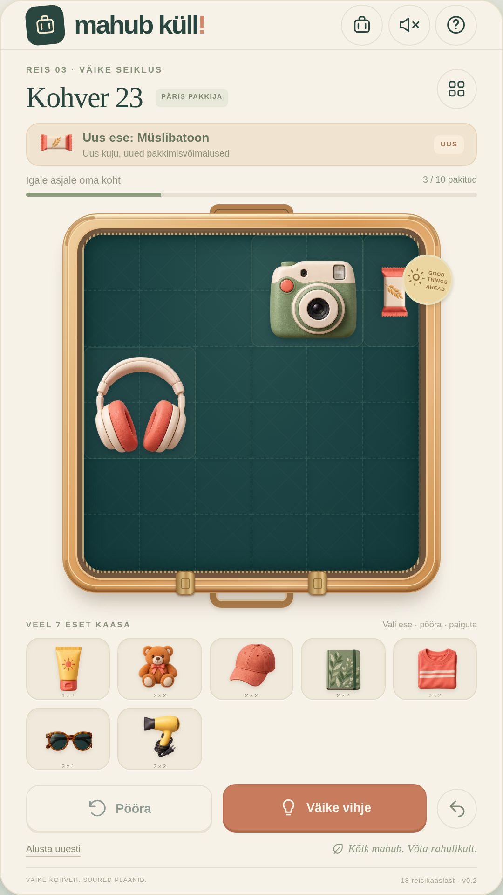

# Mahub küll!

Eestikeelne, telefonile sobiv kohvri pakkimise pusle. Paiguta ja pööra esemeid, et kõik kohvrisse mahuksid. Mäng töötab brauseris; sama veebirakendust saab Capacitoriga Androidi jaoks pakendada.

Versioonis 0.2 on 18 erinevat eset, mis avanevad kampaanias iga 1–2 taseme järel. Esimeses kohvris on neli erinevat eset. Kõigil seadmetel kasutatakse 9:16 püstvaadet; 540 × 960 CSS-piksli vaade annab kahekordse pikslitihedusega 1080 × 1920 pildi. Ülaserva kohvrinupp avab esemekogu ja uute esemete avanemise järjekorra.



## Mängu proovimine

**[Laadi arvuti prooviversioon (ZIP)](https://github.com/m2gn3tic-byte/whatever/archive/refs/heads/playtest.zip)**, paki see lahti ning ava **Mahub-kull.html** Chrome'i, Edge'i või Firefoxiga. Fail sisaldab kogu mängu ja graafikat; midagi paigaldada pole vaja. GitHubi ZIP-i allalaadimine ja testitud HTML-iga kokkulangevus on kontrollitud.

Otse veebiaadressil mängimiseks on valmis haru `gh-pages`. Selle aktiveerimiseks vali [GitHub Pagesi seadetes](https://github.com/m2gn3tic-byte/whatever/settings/pages) **Deploy from a branch → gh-pages → /(root) → Save**. Keskkonna avaldamine seda seadistust ei tee. Praegune pilve võrguühendus blokeerib GitHubi haldus-API ja Pagesi hosti, mistõttu pole otse mängitavat aadressi siit kinnitatud.

Kordusehituseks kasuta `npm run build:standalone` (tulemus `artifacts/Mahub-kull.html`) või `npm run build:pages` (tulemus `dist-pages/`). Loaga käivitatud `npm run publish:playtest` uuendab mõlemad testiharud GitHubis. Täpsed avamis- ja avaldamissammud on [testimise juhendis](docs/TESTIMINE.md).

## Arendamine

Vajalik on Node.js 22 või uuem ning npm. Kasuta olemasolevat checkout'i `/workspace/whatever`: pilveülesanne on juba eraldatud keskkonnas ning selle jaoks pole vaja uut Git worktree'd luua.

```sh
cd /workspace/whatever
npm ci
npm run dev -- --host 0.0.0.0
```

Arendusserveri aadress kuvatakse terminalis. Käivita käsud projekti juurkataloogist. Mäng ei vaja andmebaasi, kontot, API-võtit ega välist teenust.

```sh
npm test
npm run build
npm run preview -- --host 0.0.0.0
```

`npm test` käivitab puslemootori testid. `npm run build` loob avaldamiseks staatilised failid kataloogi `dist/`. Eelvaates kontrolli ka lohistamist, pööramist, vihjeid, taseme lõpetamist ja edenemise säilimist pärast lehe värskendamist.

Brauseritestid kasutavad Playwrighti. Käsk `npm run test:e2e` käivitab ise arendusserveri pordil 5173, tootmise eelvaate pordil 4173 ja Pagesi alamkataloogi kontrollserveri pordil 4273; juba töötavaid servereid kasutatakse väljaspool CI-d uuesti. Testid kontrollivad hiire- ja puutejuhtimist, 9:16 paigutust, esemete avanemist, vana edenemise üleviimist ning võrguühenduseta kasutamist. Arvutivaate pildikontroll salvestab faili `artifacts/mahub-portrait-1080x1920.png` ja kontrollib selle täpset pikslimõõtu; sama pildikontrolli telefoniprojektis ei korrata. Selles pilvekeskkonnas kasutatakse brauserit `/usr/bin/chromium`. Mujal paigalda vajaduse korral Playwrighti Chromium käsuga `npx playwright install chromium`; seda kasutatakse automaatselt, kui süsteemset Chromiumi pole. Kohandatud brauseri tee saab määrata muutujaga `CHROMIUM_PATH`.

## Mängimine ja andmed

Vali ese ja paiguta see kohvrisse. Lohistamine töötab hiire ja puuteekraaniga; pööramisnupp muudab valitud eseme suunda. Vihjenupp aitab paigutusega. Esemed peavad jääma kohvri sisse ega tohi kattuda.

Edenemine ja eelistused säilivad selle seadme brauseri kohalikus salvestusruumis. Brauseri andmete kustutamine eemaldab ka kohaliku edenemise. Selles versioonis puuduvad kasutajakontod ja pilvesünkroonimine.

Uuendamisel säilivad läbitud tasemed ja avatud kohvrid. Muutunud paigutusega pooleliolev kohver alustab uute esemetega algusest. Ühe HTML-faili puhul kasuta edenemise säilitamiseks sama brauserit ja failiasukohta.

## Võrguühenduseta kasutamine

Tootmisversioonil on veebirakenduse manifest ja service worker. Ava mäng esmalt võrguühendusega ning lase sellel lõpuni laadida. Pärast failide vahemällu salvestamist saab sama mängu avada ka võrguühenduseta. Service worker eeldab HTTPS-i või kohalikku arendusmasinat; kasutajaliidese paigaldusvõimalused sõltuvad brauserist.

Service worker salvestab ainult oma päritolu edukad GET-vastused. Muutes vahemällu salvestatud failide sisu, suurenda failis `public/sw.js` vahemälu versiooni. Arendusrežiimis ei ole service worker vajalik; võrguühenduseta käitumist kontrolli tootmise eelvaates.

## Android

Capacitori rakenduse identifikaator on `ee.mahubkull.game` ja veebifailide kataloog `dist`. Androidi projekt on kataloogis `android/` juba olemas. Pilvekeskkonnas on täis-JDK 21, Android SDK ja Gradle'i sõltuvused ette valmistatud. Praeguse veebikoodi sünkroonimiseks ja installitava prooviversiooni loomiseks:

```sh
npm run android:build
```

Tulemus on `artifacts/mahub-kull-debug.apk`. Androidi ehitus on selles pilvekeskkonnas õnnestunud ning APK allkiri on kontrollitud. Projekt toetab Android 6.0 ja uuemaid seadmeid. Päris telefonis ega emulaatoris käivitamist pole veel kontrollitud. Mängu veebifailid on APK sees ja telefon ei vaja selle käivitamiseks arendusserverit.

Tööriistade nõuded, ametlike allalaadimiste kontrollsummad, paigaldamine ja täpne ehitusjuhis on failis [docs/ANDROID.md](docs/ANDROID.md). Android Studios avamiseks kasuta `npx cap open android`.

Allkirjastatud väljalaske AAB loomine ja Google Playsse saatmine vajavad arendaja enda kontot ning allkirjastusvõtit; hoia võtmed hoidlast väljas. Enne avaldamist kontrolli ka Google Play kehtivat Androidi sihtversiooni nõuet.

See on mängitav prototüüp. Google Play ostud, reklaamivõrk, maksete valideerimine, poe materjalid ja avaldamine tuleb enne ärilist väljalaset eraldi rakendada ning päris Androidi seadmes kontrollida. Prototüüp ei tee makseid.
